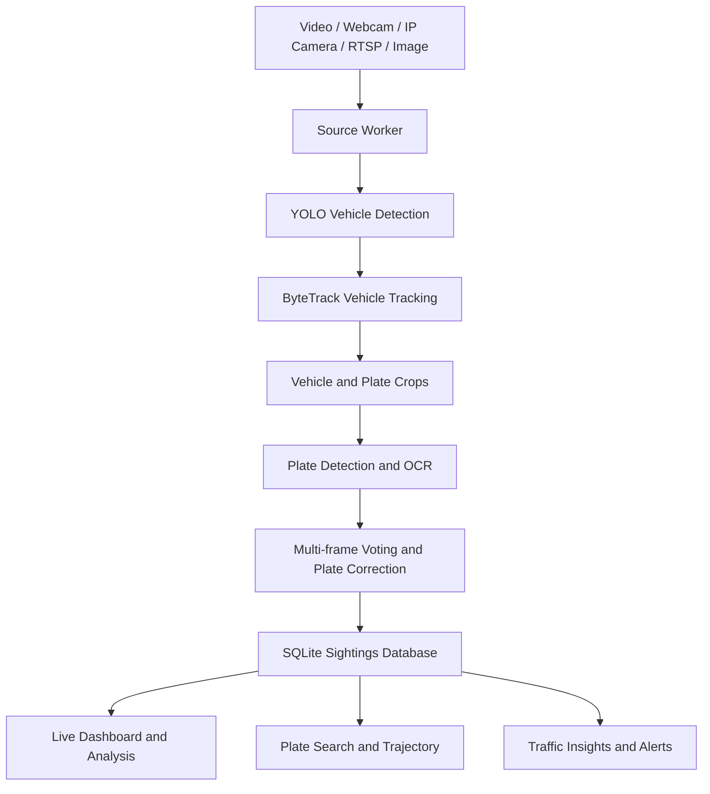

# ANPR & Vehicle Detection System

A computer-vision platform for detecting and tracking vehicles, recognizing Indian number plates, and analyzing sightings across recorded footage and live camera feeds.

The short demo highlights vehicle detection and number-plate recognition. The repository contains the wider application as well, including source management, image/video analysis, vehicle tracing on a map, traffic insights, and alert handling.

## Features

### Vehicle detection and tracking
- Detects vehicles in video using YOLO from Ultralytics.
- Tracks detections across sequential frames with ByteTrack to avoid treating every frame as a separate vehicle sighting.
- Saves vehicle crops and groups observations into track-level sightings.
- Supports recorded video, a local webcam, IP cameras, and RTSP streams through a shared source pipeline.

### Automatic Number Plate Recognition (ANPR)
- Localizes number plates on detected vehicles.
- Runs OCR over plate crops and combines readings across multiple frames to improve recognition.
- Applies format-aware correction for supported Indian registration formats and ranks fuzzy matches rather than relying only on exact string equality.
- Stores the raw OCR output, corrected plate text, confidence, candidate readings, and plate crops when available.
- Includes custom work for **two-row number plates**, including a curated dataset with manually transcribed labels used to improve recognition of stacked plate layouts.

### Full application
The web interface is organized into six main areas:

- **Live** — live sightings, source status, plate readings, confidence, and evidence crops on a map-based dashboard.
- **Sources** — add and manage webcams, network/RTSP cameras, recorded videos, and still images. Sources can be placed on the map.
- **Analyze** — inspect images or videos with annotated detections and plate results; export results as JSON or CSV.
- **Trace** — search for a plate, review ranked fuzzy matches, and view time-ordered sightings and vehicle trajectories on the map.
- **Insights** — view traffic trends such as vehicle counts over time, type distribution, source density, heatmaps, and origin-to-destination flows.
- **Alerts** — review blacklist matches and potentially impossible transitions between source locations. The blacklist and control-room number can be managed through the interface.

Additional capabilities include camera-feed previews, MJPEG camera tiles with detection overlays, WebSocket updates, source processing status, and SMS notification integration through TextBee when configured.

## How it works



Recorded footage is timestamped relative to its configured start time, while live footage uses capture-time timestamps. Accurate source locations and timestamps are important for meaningful trajectory and travel-time calculations.

## Technology stack

**Backend:** Python, FastAPI, Uvicorn, Ultralytics YOLO, OpenCV, SQLite

**Tracking:** ByteTrack

**Frontend:** React, Vite, Tailwind CSS, Leaflet, Recharts, Framer Motion

**Data storage:** SQLite in WAL mode, with a single database writer to avoid concurrent-write conflicts

**Notifications:** TextBee integration for sending blacklist alerts through a configured Android gateway device

## Custom two-row plate dataset

The repository includes a custom dataset for two-row number plates, alongside the associated preparation and evaluation work. The dataset work includes photographed examples, rendered examples, and manually transcribed plate text. A plate-disjoint train/held-out split is used so crops of the same registration do not leak across the split.

The two-row OCR model is intended to improve recognition of stacked plate layouts. Recognition is still dependent on image quality, plate size, angle, lighting, and whether the plate detector captures the full plate. A detected vehicle can therefore have no recognized plate, and OCR output should be verified rather than treated as guaranteed ground truth.

## Evaluation notes

The repository records benchmark results on a limited set of real videos and hand-labelled plates. In the documented eight-clip evaluation, the adopted two-row OCR fine-tune achieved an exact match on **2 of 4** hand-labelled plates and **80% character accuracy**; the plate-less control clip had **zero false reads** in that run. On the documented held-out two-row crop set, exact recognition was **30.3% (44 of 145)** for the fine-tuned model.

These are measurements on the listed evaluation data, not a general accuracy guarantee. The labelled real-video sample is small, and performance can vary with camera angle, resolution, lighting, motion blur, and plate visibility.

## Requirements

- Windows environment (the current setup and worker handling are designed around Windows).
- Python and the project dependencies listed in `requirements.txt`.
- Node.js and npm for building the frontend.
- A CUDA-capable NVIDIA GPU and a compatible PyTorch/CUDA installation for the configured inference pipeline.
- The model weights expected by `config/settings.yaml` available under `models/`.

The model-weight files may be large. Confirm that the required weights are present before starting the application; model paths are configured in `config/settings.yaml`.

## Setup and run

Open **Command Prompt** from the repository directory.

1. Create and activate the Python environment:

   ```bat
   python -m venv env
   env\Scripts\activate.bat
   ```

2. Install the Python dependencies:

   ```bat
   pip install -r requirements.txt
   ```

   Make sure the installed PyTorch build is compatible with the machine's CUDA setup. Do not replace a working CUDA-enabled build with a CPU-only build.

3. Build the frontend:

   ```bat
   cd web
   npm install
   npm run build
   cd ..
   ```

4. Check that the required model weights and configuration files are present, then start the application:

   ```bat
   python -m app.run
   ```

FastAPI serves the API and the built frontend from `web/dist`. Use the local URL printed by the application. The health endpoint is available at `/api/health` on that same host and port.

> If the repository's dependency file, frontend scripts, model weights, or local configuration differ from this setup, follow the files in the checkout and update this section to match the version being published.

## Configuration

The main configuration files are:

- `config/settings.yaml` — model paths, inference settings, and notification settings.
- `config/sources.yaml` — seed sources loaded on first run; sources added through the UI are stored as application state.
- `config/blacklist.yaml` — blacklist entries used by the alert system.

For SMS alerts, configure the following environment variables on the machine running the backend:

- `TEXTBEE_API_KEY` — TextBee API key.
- `TEXTBEE_DEVICE_ID` — ID of the registered TextBee device.
- `ANPR_POLICE_NUMBER` — optional fallback control-room number in international format, such as `+91...`.

The control-room number can also be set from the Alerts interface. SMS sending depends on a correctly configured TextBee account and its registered Android device. An API acceptance response does not, by itself, confirm delivery by the phone or carrier.

## Using the application

1. Start the application and open the local URL shown in the terminal.
2. In **Sources**, add a webcam/network stream, upload a recorded video, or add image(s).
3. For recorded footage, set the correct start time and location when these are needed for map-based analysis.
4. Open **Live** to view incoming sightings, or **Analyze** to inspect an image/video independently.
5. Use **Trace** to search for a recognized plate and inspect ranked matches and the associated route.
6. Use **Insights** and **Alerts** to review traffic patterns and configured alert conditions.

## Known limitations

- OCR can fail when plates are small, blurred, angled, obscured, or poorly lit.
- Fuzzy plate matching returns ranked candidates; similar-looking characters can still produce incorrect readings.
- Cross-camera vehicle re-identification remains imperfect when the same vehicle looks substantially different from different viewpoints. Trajectories should be interpreted with that limitation in mind.
- Trajectory and implied-speed calculations depend on correct camera coordinates and timestamps.
- SMS delivery is not guaranteed merely because the notification gateway accepted a request.
- The app is not configured with user authentication. Keep it on a trusted local network unless access controls are added before deployment.

## Data, privacy, and responsible use

Number plates and camera footage may contain sensitive personal or location information. Only process footage you are authorized to use, restrict access to captured data, and avoid committing private footage, credentials, or unredacted personal data to a public repository. ANPR results are probabilistic and should be reviewed by a person before being used to make consequential decisions.

## Repository areas

| Path | Purpose |
|---|---|
| `app/` | Backend pipeline, detection, OCR, tracking, matching, tracing, and alert logic |
| `web/` | React/Vite frontend |
| `config/` | Application, source, and blacklist configuration |
| `models/` | Model weights referenced by the application |
| `data/` | Vehicle, plate-detection, and OCR datasets/splits |
| `scripts/` | Dataset preparation, training, and evaluation scripts |
| `footage/` | Local evaluation videos and clips, where included |
| `scratch/` | Experiments and intermediate evaluation artefacts |

## Contributors

Add the project contributors and their GitHub profiles here:

- `[Name](https://github.com/username)`
- `[Name](https://github.com/username)`

---

**Note:** The demo video shows selected parts of the system. Refer to the repository and the application screens for the broader feature set.
